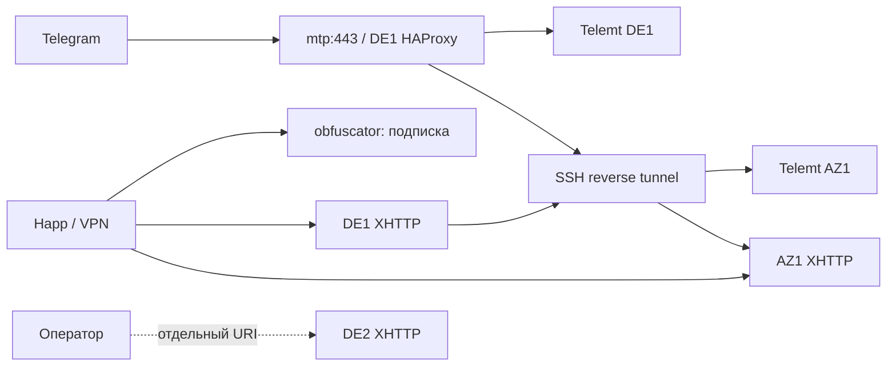

# Подписки и управление клиентами

Текущая схема (28.10.2026):

- `obfuscator.funsociety.dev`: приватные VPN-подписки Happ/v2ray-совместимых клиентов. Формат — base64 списка VLESS/XHTTP URI; `?format=plain` возвращает текст. Основной список всегда **DE1 + AZ1**.
- `mtp.funsociety.dev`: единый FakeTLS MTProto-вход. HAProxy распределяет новые соединения между Telemt на DE1 и AZ1 через сохранённый обратный SSH-туннель. У одного клиента одинаковый секрет на двух backend, у разных клиентов секреты разные.
- **DE2 скрыт**: даже после `grant-de2` его нет в подписке. CLI выдаёт отдельный VLESS URI только этому клиенту.
- Старые ключи, x-ui DB, MTProto DE1:8888 и прежний AZ1 MTProto сохранены. Агент управляет только собственными новыми UUID и отдельным Telemt, а не старой базой x-ui.

Корень сайта не раскрывает ключи: клиенту нужна персональная ссылка. Подписка — bearer credential: её владелец получает VPN-конфигурацию. Не публиковать URL и не включать их в git.

## Использование

На рабочем Mac из корня репозитория:

```sh
python3 Subscriptions/cli.py add phone
python3 Subscriptions/cli.py list
python3 Subscriptions/cli.py links phone
python3 Subscriptions/cli.py disable phone
python3 Subscriptions/cli.py enable phone
python3 Subscriptions/cli.py grant-de2 phone
python3 Subscriptions/cli.py revoke-de2 phone
python3 Subscriptions/cli.py rotate-vpn phone
python3 Subscriptions/cli.py rotate-mtp phone
python3 Subscriptions/cli.py rotate-link phone
python3 Subscriptions/cli.py sync
python3 Subscriptions/cli.py baseline
```

Доступ нужен через `user@192.168.0.192`, далее `deploy@узел:2222`. На каждом узле должна быть открыта **одна idle root tmux-панель** `0:0.0` (её запускает оператор через `sudo su`). Постоянных sudoers-разрешений агенту нет. Не вводить команды в эту панель во время синхронизации. Локальный lock сериализует CLI. Если root tmux закрыт после перезагрузки, VPN, подписки, MTProto, DDNS продолжают работать; для изменения клиентов оператор снова открывает root tmux.

CLI печатает Subscription URL и HTTPS Telegram URL. Первый добавляется как подписка Happ. Второй открывается в браузере и перенаправляет в Telegram на `tg://proxy` с индивидуальным секретом. Список серверов обновляется по прежней subscription URL. Автоматическое переключение VPN зависит от клиента; наличие двух URI само по себе не гарантирует failover активных соединений.

`disable` закрывает URL и удаляет **новые управляемые** ключи со всех узлов; legacy-клиенты остаются. Уже открытый поток может жить до перезапуска сервиса; изменение управляемого списка сейчас перезапускает Xray/Telemt и может кратковременно оборвать соединения. Все операции идемпотентны, но распределённой транзакции нет: при ошибке `pending_sync=True`, устранить проблему и повторить `sync`.

Состояние оператора — `.secrets/clients.json` (0600, каталог 0700, вне git), содержит UUID, MTProto-секреты, токены и права DE2. Обязательно сохранять его в зашифрованную резервную копию. На узлах `/etc/obfuscator-managed/owned.json` — список принадлежащих агенту клиентов; потеря этого файла опасна для последующего отзыва. Не восстанавливать один файл отдельно от соответствующих конфигураций.

## Топология



AZ1 VPN hostname — `vpn-az1.obfuscator.funsociety.dev`: DDNS выбирает реальный IP RPi после внешней TLS-проверки с DE1. Если проброс портов не проходит/CGNAT, DNS указывает на DE1, который ведёт XHTTP через reverse tunnel. Единый DDNS обновляет также `az1.obfuscator.funsociety.dev`; старый MTProto-секрет сохраняется, а SNI попадает на прежний mtg за HAProxy. Оба имени выбирают direct только после внешней проверки, иначе relay. `mtp` и подписка пока зависят от DE1: это резерв backend, не отказоустойчивость публичного IP.

TCP health check HAProxy (5 секунд, fall 3/rise 2) проверяет доступность listener, а не аутентификацию в Telegram. Обрыв активного TCP не переносится между backend бесшовно; клиент переподключается. Проверка из РФ остаётся отдельной приёмкой. MTProto не заменяет VPN для звонков: для голосовых/видеозвонков использовать VPN/TUN с UDP, проверять на телефоне.

## Код и версии

- `server.py` — локальный HTTP delivery 127.0.0.1:9080 за nginx TLS, без access log с приватными URL.
- `node_agent.py` — root-owned JSON агент, только управляемые UUID; контроль старых ключей по хешам, резервные копии на узлах; никаких sudoers-прав deploy.
- `cli.py` — клиенты и секреты, вызовы через существующий root tmux.
- `config/`, `systemd/`, `scripts/` — конфигурационные шаблоны и установщики. Никаких рабочих клиентских секретов в шаблонах.
- Telemt **3.5.14**, Linux musl x86_64 / aarch64; SHA256 проверяется установщиком.
- AZ1 Xray **26.3.27** ARM64; DE1/DE2 сохраняют существующий pinned Docker. XHTTP `stream-up`, TLS/nginx/h2.

[Эксплуатационные runbooks](runbooks/operations/README.md) · [Полная установка и восстановление](runbooks/installation/README.md).

Официальные форматы: [Happ: subscription](https://github.com/HappDev/happ_su/blob/main/faq/adding-configuration-subscription.md), [Telemt 3.5.14 configuration](https://github.com/telemt/telemt/blob/3.5.14/docs/Config_params/CONFIG_PARAMS.en.md), [Xray XHTTP](https://github.com/XTLS/Xray-core/discussions/4113).

[Фактическое развёртывание и результаты проверок](DEPLOYMENT.md).

[Прямой вход AZ1: диагностика CGNAT и подключение публичного IP](runbooks/operations/az1-public-ingress.md).
