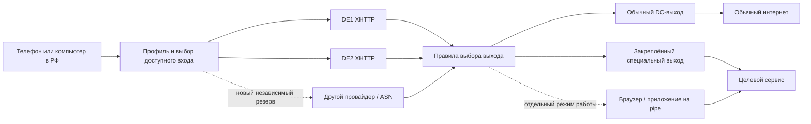

# Развитие Obfuscator: устойчивый вход из РФ и отдельная выходная среда

Дата: 28.10.2026. Это архитектурный план, а не инструкция к немедленному переключению production. При подготовке прочитаны текущие документы проекта, официальные материалы решений и несекретный инвентарь pipe. Настройки серверов не менялись.

## Уточнённые приоритеты владельца

Целевые сервисы: **Telegram, Claude, Grok, ChatGPT, Discord, Google Pay**. **Германия допустима как страна выхода.** Это уточнение задаёт порядок пилотов ниже; профили пока не применены на серверах.

| Профиль | Сервисы | Предпочтительное поведение | Приёмочный тест |
|---|---|---|---|
| **AI-DE** | Claude, Grok, ChatGPT | закреплённый немецкий exit; вход может переключаться; менять exit только явно | обычный вход в существующий аккаунт, длинный ответ без обрыва, загрузка файла при необходимости; отдельно мобильное приложение и браузер |
| **Realtime-DE** | Telegram, Discord | быстрый исправный маршрут, рабочий UDP через TUN, удержание маршрута на время звонка | сообщения, медиа, двусторонний голос и видео 10–15 минут; воспроизвести потерю основного входа и зафиксировать переподключение |
| **Payments-DE** | Google Pay / Google Wallet | отдельная диагностика native-приложения и/или web-оплаты; без фоновой смены выхода во время операции | доступность нужного сценария без автоматических списаний; отдельно проверить карту/банк, региональную доступность и устройство |
| **Browser-DE** | браузерные версии AI-сервисов при необходимости | настоящий постоянный профиль на pipe с явно заданным немецким выходом | долговременная сессия, совпадение ожидаемого egress, отсутствие обхода через обычную AZ-сеть |

### Что это меняет в архитектуре

1. **Первый специальный профиль — AI-DE**, с DE2 как исходным кандидатом закреплённого выхода: его XHTTP уже подтверждён владельцем из РФ. Проверить вариант `клиент → DE1 → DE2 → сервис` и прямой вход DE2 с тем же exit. При падении самого DE2 сохранение его IP невозможно обычной сменой входа; строгий профиль приостанавливается либо пользователь явно выбирает новый exit.
2. **Telegram и Discord проверять отдельно от AI.** Существующий MTProto AZ1 полезен для Telegram-сообщений, но не заменяет TUN для звонков и не обслуживает Discord. UDP приложения может передаваться внутри туннеля; требуется тест именно его доставки, а не только открытого UDP-порта сервера. Discord прямо указывает необходимость UDP при использовании VPN. [Discord: Voice Connection Errors](https://support.discord.com/hc/en-us/articles/115001310031-Voice-Connection-Errors).
3. **Pipe находится в Азербайджане.** Его прямая сеть не является немецким выходом. Для Browser-DE нужен маршрут браузера pipe через немецкий exit; он сохранит реальную среду приложения, но немецкий IP останется IP выбранного DC. Если проблема окажется именно в репутации дата-центра, нужна проверка другого exit, а не дополнительных hop в той же DC-сети.
4. **Google Pay нельзя объявить исправленным по одному немецкому IP.** Для Wallet важны поддержка банка/карты, NFC-сценарий и требования безопасности Android. Удалённый Linux-браузер pipe не заменяет Wallet/NFC на телефоне. Сначала выяснить, требуется ли бесконтактная оплата, добавление карты или web-оплата. [Методы оплаты в Германии](https://support.google.com/wallet/answer/12059326?co=GENIE.CountryCode%3DDE&hl=en-GB), [требования и диагностика Wallet](https://support.google.com/wallet/answer/12200245?hl=en).
5. В UI показывать три отдельных результата: **туннель работает / сервис доступен / сценарий пользователя проходит**. Ответ 403, ограничение аккаунта, неработающий голос и неподдерживаемая карта не должны автоматически запускать бесконечную ротацию VPN-хостов.

Германия присутствует в опубликованных списках доступа [ChatGPT](https://help.openai.com/en/articles/7947663-chatgpt-supported-countries) и [Claude](https://support.claude.com/en/articles/8461763-where-can-i-access-claude). Это подтверждает пригодность страны как кандидата, но не доступность любого аккаунта из любого местонахождения. Для Grok отдельно тестируются используемая версия/приложение и аккаунт; документация X описывает Grok внутри X и не заменяет проверку standalone grok.com. [Grok в X](https://help.x.com/en/using-x/about-grok).

Порядок практического пилота: **AI-DE → звонки Telegram/Discord → разбор конкретного сценария Google Pay → Browser-DE, если сетевого профиля недостаточно**. Существующий MTProto продолжает обслуживаться параллельно.

## 1. Предлагаемое направление

Сохранить **Xray/VLESS/XHTTP как проверенную основу входа**, добавить независимый резерв входа и измеряемое переключение. **Выходную сеть выбирать отдельной политикой**, а для сервисов, которым важен браузерный контекст, развивать выделенные приложения/браузерные профили на pipe.

Четыре самостоятельных слоя:

1. **Вход:** какие IP/домены/транспорты доступны конкретному клиенту из РФ.
2. **Маршрут:** как выбранный вход достигает нужного выходного узла.
3. **Выход:** какой IP/провайдер/страна виден сервису, стабильность этого адреса.
4. **Приложение:** настоящий браузер, профиль, cookies, TLS/HTTP, DNS, WebRTC, разрешения и состояние сессии.

Первые три слоя можно управлять сетью. Четвёртый требует контроля приложения. Дополнительный туннель не меняет браузерный профиль клиента автоматически и не гарантирует принятие соединения сервисом.

**Первый практический результат:** одна подписка/набор профилей с DE1+DE2, диагностикой и безопасным резервированием входа; затем отдельный экспериментальный профиль выхода через AZ/pipe. Полную собственную VPN-панель с нуля на первом этапе не разрабатывать.

## 2. На что уже можно опереться

### Зафиксированная инфраструктура

- DE1: HAProxy на 443 разделяет SNI AZ1 MTProto и DE1 XHTTP. Новый Xray работает независимо от старого x-ui; MTProto 8888 сохранён.
- DE2: отдельный nginx + Docker Xray/VLESS/XHTTP `stream-up`, работа из РФ подтверждалась владельцем.
- AZ1: mtg, сертификат, DDNS и постоянный обратный SSH-туннель в DE1. Из-за CGNAT AZ1 не является независимым публичным входом.
- DE1 и DE2 размещены в DigitalOcean; считать их полностью независимыми по провайдеру/сетевой блокировке нельзя.
- AZ1 и pipe находятся в одном LAN за одним роутером. Для расчёта доступности это общая зависимость от домашнего интернета, роутера и питания, пока не проверено обратное.

### Что дополнительно найдено на pipe 28.10

- Linux Mint 22.3, настоящая графическая desktop-среда; установлен Firefox, каталог Brave, Happ.
- Исходники и бинарник `proxy-ns`: отдельный namespace, TUN/gVisor, передача TCP/UDP через SOCKS5. Это готовый инструмент для изолированного запуска приложения.
- В домашнем `/home/user/xray/config.json` есть локальные SOCKS/HTTP-входы и VLESS/XHTTP outbound.
- Работающий `xray.service` использует **другой** путь: `/usr/local/etc/xray/config.json`. В прочитанном файле не обнаружены массивы входов/выходов, описанные в домашнем конфиге; слушающих 10808/10809 в основном namespace при проверке нет.
- Обнаруженный процесс Firefox находится в том же network namespace, что и обычная SSH-сессия. Сам факт установки proxy-ns не подтверждает изоляцию этой браузерной сессии.

Вывод: на pipe есть хорошая основа для профиля приложений и предыдущие наработки цепочки. Её нужно оформить в проверяемый сервис и установить фактический маршрут. Сейчас нельзя считать pipe уже готовым отказоустойчивым специальным шлюзом.

Источники: [proxy-ns upstream](https://github.com/OkamiW/proxy-ns), локально прочитанные README/Go-код и безопасные поля конфигураций. Секреты, cookies и содержимое браузерных профилей не изучались.

## 3. Целевая архитектура

`Правила выбора выхода` — логическая функция на выбранных узлах, **не обязательный центральный сервер**, через который должен идти весь трафик. Её реализация не должна создавать ещё одну точку отказа.

Отдельный контур управления: inventory → генерация конфигурации → проверки → доставка → наблюдение. При недоступности панели уже установленные конфигурации продолжают работать.

### Три пользовательских профиля

| Профиль | Вход | Выход | Поведение при сбое |
|---|---|---|---|
| Обычный VPN | доступный DE1/DE2/резерв | разрешённый быстрый DC | автоматически выбрать доступный вход для новых соединений |
| Стабильный выход | доступный вход | закреплённый exit для профиля | сохранить exit при смене входа; при потере exit остановить профиль или запросить переключение |
| Браузер на pipe | защищённый доступ к приложению | выбранная сеть pipe/его изолированного приложения | сохранить браузерный профиль; запретить незаметный выход через другую сеть |

Обычный браузер пользователя через специальный exit и браузер, реально запущенный на pipe, — разные варианты. UI должен показывать, какой именно используется.

## 4. Балансировка и up/down: как это должно работать

### Что измерять

Хранить состояние **маршрута для источника**, например `RU-mobile-A → DE2/XHTTP → AZ-exit`, а не один зелёный индикатор сервера.

Пять проверок:

1. Процесс/контейнер и локальные ресурсы.
2. TCP/TLS, правильный сертификат и SNI.
3. Реальный аутентифицированный проход через VLESS/XHTTP с отдельными probe-credentials.
4. Доступ к двум независимым нейтральным endpoint, ожидаемый выходной IP, DNS, UDP при необходимости.
5. Доступность выбранного сервиса через профиль; HTTP 403/географический отказ/CAPTCHA классифицируются отдельно от сетевого отказа.

Добавить измерения минимум из **двух независимых сетей РФ**, желательно фиксированной и мобильной. Наш успешный тест с DE2 не говорит о проходимости у конкретного российского оператора. Если RU-проб нет, UI показывает `не проверено из РФ`, а не `работает в РФ`.

### Начальные параметры для пилота

Это предлагаемая политика, а не уже измеренные SLO:

- лёгкие проверки раз в 15–30 секунд с небольшим jitter;
- DOWN после 3 последовательных ошибок; возврат после 2–3 успешных проверок;
- минимальное удержание выбранного входа 120 секунд, чтобы исключить постоянные переключения;
- состояния `healthy`, `degraded`, `blocked-from-source`, `unknown`, `maintenance`, `down`;
- `unknown` не считать доказанно исправным в строгом профиле;
- новые соединения направлять в исправный маршрут; активные сессии по возможности оставлять на прежнем;
- предусмотреть ручной drain узла перед обновлением.

Переключение хоста обычно разрывает уже существующие TCP-сессии/звонки. Бесшовную миграцию между независимыми Xray-серверами не обещать. DNS round-robin и несколько A-записей сами по себе не обеспечивают проверку доступности или быстрый failover.

### Где балансировать

- **На клиенте:** основной способ пережить недоступность входного IP/домена. Требуется реально поддерживаемый клиентом формат профилей/подписки и переключения.
- **В Xray на сервере:** выбор дальнейшего выхода, когда вход уже доступен. Есть routing balancers и Observatory. `leastPing`/`leastLoad` зависят от наблюдений; нужно явно проектировать fallback и исключить нежелательный прямой выход. [Xray routing](https://xtls.github.io/en/config/routing.html), [Observatory](https://xtls.github.io/en/config/observatory.html).
- **HAProxy:** оставить для SNI и локального обслуживания backend. TCP check подтверждает только доступность TCP; аутентифицированную VPN-проверку выполнить отдельным probe. [HAProxy health checks](https://www.haproxy.com/documentation/haproxy-configuration-tutorials/reliability/health-checks/).

Для старта предпочесть управляемый резерв основного входа и сбор данных. Распределение нагрузки вводить, когда появятся измеренные ограничения CPU/канала. Случайная смена exit между запросами для чувствительных сервисов не нужна.

## 5. Связки хостов и устойчивость к обнаружению

Каждый дополнительный hop должен иметь понятную функцию:

- `клиент → XHTTP-вход → обычный выход`: минимальные задержка и число зависимостей;
- `клиент → вход-A или вход-B → стабильный exit`: независимая смена входа с сохранением выходной сети;
- `клиент → вход → pipe-приложение`: запуск реального приложения в выбранной среде;
- MTProto AZ1 остаётся отдельной Telegram-веткой; VPN-балансировщик не превращает его в универсальный канал.

Вход видит клиентское подключение и соединение со следующим узлом. Exit видит назначения и исходящий поток. HTTP/TLS приложения сохраняется до сервиса при обычном туннелировании; внешний TLS транспорта и внутренний TLS браузера — разные соединения. Выбор uTLS на Xray-входе не заменяет браузерный fingerprint, cookies или географию exit.

Приоритеты:

1. Добавить резерв в **другом провайдере/ASN**, а не только ещё одну машину в той же сети.
2. Сохранить XHTTP основным проверенным транспортом. Протоколы оценивать по матрице российских операторов.
3. REALITY оставить отдельным лабораторным профилем. Почему старые настройки не работали, ещё не диагностировано; это не доказательство, что вся технология непригодна.
4. Hysteria2 рассмотреть как дополнительный транспорт для сетей, где проверенно доступен UDP. Не делать его единственным резервом TCP/XHTTP. [Официальная конфигурация](https://hysteria.network/docs/advanced/Full-Server-Config/).
5. XHTTP через CDN исследовать отдельным canary-профилем: режим транспорта, HTTP/2/3, streaming, buffering, ограничения провайдера и фактическая доступность должны быть проверены. Это не переключение одной DNS-настройки на текущем `stream-up`. [Обсуждение XHTTP авторами](https://github.com/XTLS/Xray-core/discussions/4113).

Цепочка в 3–4 сервера добавляет задержку и зависимости. Два hop не дают гарантии анонимности или принятия сервисом. Общий публичный DE1-IP сейчас объединяет риск блокировки XHTTP DE1 и MTProto AZ1.

## 6. Специальный exit и «реалистичная среда»

### Сначала определить, что требуется сервису

Для каждого целевого сервиса собрать паспорт профиля:

- требуемая страна, допустимые выходные сети и стабильность IP;
- обычный браузер/мобильное приложение или необходимость удалённого браузера;
- срок сохранения сессии и допустимость смены IP;
- необходимые API/CDN/login-домены, DNS и UDP/WebRTC;
- измеренный результат доступа и причина отказа, если она известна.

IP домашнего провайдера может отличаться по восприятию от IP дата-центра, но принадлежность к определённому типу сети не гарантирует доступ. CGNAT-адрес также может быть общим для большого числа абонентов. Начать с собственной сети AZ/pipe и измерений, без покупки случайных «residential»-пулов.

### Два режима pipe

**A. Выходной шлюз.** Трафик клиента выходит через согласованную сеть pipe, приложение остаётся на телефоне/ноутбуке. Цель — нужный IP и маршрут. Настройки браузера автоматически не меняются.

**B. Выделенное приложение.** На pipe запускается обычный поддерживаемый браузер с постоянным профилем и заданным сетевым маршрутом. Пользователь получает защищённый доступ к этой сессии. Цель — реальная целостная среда и сохранённое состояние, без необходимости генерировать вымышленные отпечатки.

Для B использовать уже имеющийся proxy-ns как один из кандидатов изоляции. Следует проверить DNS, TCP, UDP, IPv6, WebRTC и поведение при падении SOCKS. Его FakeDNS/UDP-ограничения описаны самим проектом; наличие исходников не заменяет такой тест. [proxy-ns](https://github.com/OkamiW/proxy-ns).

WebRTC может раскрывать адреса и обходить обычный application proxy при разрешённом прямом доступе; это проверяется отдельно. [RFC 8828](https://www.rfc-editor.org/rfc/rfc8828.html).

### Требования к exit

- Конкретный профиль закреплён за конкретным exit; смена входа его не меняет.
- При потере специального exit применяется **fail-closed**. Прямой `freedom` не становится скрытым запасным вариантом.
- Разрешён только согласованный транзит; нет публичного SOCKS без аутентификации и доступа к домашней LAN через пользовательский VPN.
- DNS, IPv6 и UDP проходят через предусмотренный профиль либо явно отключены с понятным UI-статусом.
- Не весь трафик пользователей отправляется через домашнюю сеть. Нужны лимиты канала и ограниченные группы использования.
- Обратный `ssh -R` переносит TCP. Для полноценного exit с UDP/звонками требуется отдельная поддерживающая UDP схема; нынешнего MTProto-туннеля недостаточно.
- Правила сетевого уровня задаются доменами/адресами/профилями. Произвольные URL paths внутри HTTPS недоступны сетевому роутеру без участия приложения; TLS-перехват для этого не предлагается.

## 7. Существующие решения: сравнительный выбор

| Решение | Что взять | Где потребуется наша доработка | Рекомендация |
|---|---|---|---|
| **Xray + Observatory/balancers** | существующий core, маршрутизация и наблюдение outbound | RU-пробы, exit-политика, UI, проверка фактического сервиса | сохранить как data plane |
| **Remnawave** | централизованные nodes/hosts/users, Config Profiles, шаблоны | внешние проверки маршрутов, pipe/MTProto/systemd, особая политика exit | первый кандидат control plane для пилота |
| **Marzban + Marzban-node** | Xray-панель, удалённые узлы, REST API | те же egress/health функции; проверить импорт и нужный XHTTP-клиент | второй кандидат при неудобстве Remnawave |
| **Hiddify Manager** | интегрированный набор протоколов и настройки узлов | согласование владения ingress/сертификатами с нашим HAProxy, совместимость конкретных клиентов | отдельный стенд, без установки поверх действующей схемы |
| **3x-ui** | привычное управление единичным узлом, текущая Telegram-ветка | проектная оркестрация и сквозное состояние маршрутов | оставить legacy на время миграции |
| **sing-box / клиентские selector, URLTest** | полезная модель автоматического/ручного выбора | проверить XHTTP именно в конкретном core/build; не выводить совместимость из одного слова VLESS | кандидат клиентского слоя после теста |
| **NetBird либо Tailscale/Headscale** | приватное управление, peer connectivity/маршруты | отдельный DPI-resistant вход из РФ всё равно нужен | выбрать один вариант для management/межузловой сети при росте |
| **Prometheus + blackbox exporter + Grafana** | метрики, dashboards, HTTP/TCP/DNS-проверки | аутентифицированный Xray probe и проверки из РФ | использовать для наблюдения, не считать его VPN-балансировщиком |
| **proxy-ns / обычный браузер на pipe** | уже установленная изоляция приложений через SOCKS | supervisor, стабильный профиль, UDP/leak/fail-closed тесты, приватный доступ | отдельный продуктовый профиль |

Подтверждённые возможности и ограничения:

- Remnawave отделяет панель от Xray node; Hosts выдаются в подписках. Config Profile содержит полный Xray-шаблон. Это подходит для централизованного управления, но не доказывает автоматический failover конкретного телефона. [Nodes](https://docs.rw/learn-en/nodes/), [Hosts](https://docs.rw/learn-en/hosts/), [Config Profiles](https://docs.rw/learn-en/config-profiles/).
- У Marzban есть REST API; удалённые узлы — отдельный проект. [Marzban](https://github.com/Gozargah/Marzban), [Marzban-node](https://github.com/Gozargah/Marzban-node).
- Hiddify Manager предлагает настройки протоколов, доменов и связанных узлов. Его apply/reinstall управляет сервисами, поэтому совместное владение тем же ingress без отдельной миграции рискованно. [Официальное руководство](https://hiddify.com/manager/configuration-and-advanced-settings/How-to-configure-Hiddify-panel-properly/).
- URLTest sing-box выбирает outbound по URL-проверке. Поддержку нашего XHTTP нужно подтвердить отдельно: в официальном разделе V2Ray transport XHTTP при проверке не указан. Конкретные приложения/форки могут отличаться. [URLTest](https://sing-box.sagernet.org/configuration/outbound/urltest/), [transport](https://sing-box.sagernet.org/configuration/shared/v2ray-transport/).
- NetBird имеет network routes; Tailscale — exit nodes. Их роль в проекте сначала management/inter-node, не обещание обхода DPI. [NetBird](https://docs.netbird.io/manage/network-routes), [Tailscale](https://tailscale.com/docs/features/exit-nodes).
- [blackbox exporter](https://github.com/prometheus/blackbox_exporter) использовать вместе с реальным VPN probe, а не вместо него.

**Выбор для старта:** Xray + существующий HAProxy/nginx; Remnawave на отдельном стенде; небольшой слой политик и наблюдения Obfuscator; pipe как изолированный пилот exit/application. Для 3–4 узлов достаточно существующего SSH-управления; mesh вводить по конкретной необходимости.

## 8. UI и гибкие настройки

Сначала операторский UI, затем упрощённый пользовательский. Если панель закрывает типовую функцию, использовать её API, а не дублировать собственную базу пользователей.

### Основные экраны

1. **Карта маршрутов:** вход → exit → сервис, реальное состояние по источникам/операторам, причина ошибки, время последней успешной пробы.
2. **Профили:** «обычный VPN», «стабильный выход», «браузер pipe»; выбранная страна/exit; режим автоматического переключения.
3. **Политики:** группы доменов, приоритет правил, DNS/IPv6/UDP, fail-closed, разрешённые резервы и минимальное время удержания.
4. **Узлы:** drain/maintenance, лимиты CPU/канала, сертификаты, версия и digest, роли и зависимости. AZ1 показывать зависимым от релея DE1.
5. **Приложения pipe:** запуск/остановка разрешённого профиля, назначенный exit, текущая проверка маршрута; без раскрытия cookies/паролей операторам сети.
6. **Изменения:** план применения, diff без секретов, проверка конфигурации, результат canary, откат к предыдущей версии.
7. **Пользователи/устройства:** выдача и отзыв отдельных credential, совместимость клиента, подписка и ручной резерв.

### Безопасная модель применения

- Один владелец каждого конфигурационного файла. Панель, x-ui и shell-скрипт не должны независимо перезаписывать один Xray-конфиг.
- Хранить желаемое состояние/профили отдельно от секретов. В diff и метриках — ссылки на secret, а не raw UUID/токены.
- Агенту разрешать конкретные действия: validate/apply/restart/status. UI не получает произвольную root-shell по HTTP.
- Применение: render → schema/core validation → локальный старт/canary → проверка маршрута → переключение → автоматический откат при регрессии.
- У панели приватный доступ, разграничение действий и журнал изменений. Остановка панели не останавливает туннели.
- Метрики содержат коды причин и агрегаты; содержимое трафика и полные пользовательские URL не нужны для решения up/down.

## 9. Дорожная карта с критериями готовности

| Этап | Работы | Критерий завершения |
|---|---|---|
| **0. Контракты и инвентарь** | роли узлов, зависимости, владелец конфигов, версии, нужные клиенты и целевые сервисы; восстановление из backup | новую тестовую ноду можно воспроизвести; секреты отдельно; известен фактический pipe data path |
| **1. Измерения** | probes DE1/DE2/AZ1, центральная история, две точки из РФ, проверки TCP/UDP/DNS/exit | видно, где ломается маршрут; `unknown` отличается от `down`; есть baseline минимум за несколько суток |
| **2. Резерв входа** | подписка DE1+DE2, canary профиль клиента, правила переключения, третий ASN после оценки данных | отключение DE1 не блокирует обычный VPN; новые соединения уходят в резерв; клиентские ограничения документированы |
| **3. Специальный exit** | pilot одного сервиса через собственную AZ-сеть, закрепление exit, отсутствие прямого обхода | вход меняется, exit остаётся; потеря exit не отправляет трафик напрямую; проверены DNS/UDP/IPv6 |
| **4. Pipe application profile** | обычный браузер + постоянный профиль + проверенный namespace/маршрут, закрытый удалённый доступ | реальные браузерные сессии работают; при падении прокси маршрут закрывается; нет обхода через обычную сеть |
| **5. Пилот панели** | Remnawave на тестовой машине; импорт копии профиля; API-интеграция probes/политик | UI создаёт тестовый профиль без конфликтов портов/сертификатов; пользователи и откат работают; рабочие узлы ещё можно обслужить без панели |
| **6. Надёжность и протоколы** | третий провайдер, второй relay MTProto, резерв приложения/питания; Hysteria2/CDN как canary при необходимости | проведены fault tests; версия обновляется по одному узлу; есть независимый аварийный доступ |

Первый вертикальный срез: **измеряемый DE1/DE2 failover + один закреплённый exit-профиль**. UI карты/профилей можно сделать раньше полной миграции управления. Не включать все новые протоколы и все exit одновременно — иначе невозможно связать улучшение/регрессию с изменением.

### Проверки перед переводом на постоянное использование

- Выключить основной вход; убедиться в поведении нового и уже активного соединения.
- Отрезать канал к exit; убедиться в отсутствии незаметного direct fallback.
- Отключить DNS, UDP либо IPv6 по отдельности; UI должен показать конкретный сбой.
- Перезапустить proxy-процесс, контейнер, узел и control plane по отдельности.
- Сменить вход во время долгой браузерной сессии; проверить неизменность exit.
- Применить заведомо неправильный конфиг на canary; убедиться, что production не переключился.
- Восстановить один узел из backup без чтения секретов из git.
- Выполнить реальный звонок/видео с телефона через TUN; успешного HTTPS-запроса для этого недостаточно.

Предлагаемые первоначальные цели: обнаружение отказа и переключение новых соединений в пределах 30–90 секунд в поддерживаемом клиенте; отсутствие direct fallback в специальных профилях; предсказуемое восстановление после reboot. Это цели пилота, их нужно измерить, а не объявлять гарантией.

## 10. Потребности и открытые вопросы

- Доступные для проб российские сети и конкретные приложения Android/iOS/desktop.
- Сервисы и страна уже уточнены: Telegram, Claude, Grok, ChatGPT, Discord, Google Pay; Германия подходит. Остаются число пользователей/сессий и конкретный сценарий Google Pay (Wallet/NFC либо web).
- Что именно должно идти через специальную среду: весь телефон, одно приложение, отдельный браузер или только выбранные домены.
- Допустима ли пауза при потере специального exit; какие изменения страны/IP требуют ручного решения.
- Бюджет независимого ASN/провайдера и место для панели/метрик. На существующих узлах около 1 GiB RAM; базу панели и тяжёлую observability не добавлять туда без измерения ресурсов. Отдельная management VM — предпочтительный вариант; её размер определить стендом.
- Домашняя сеть AZ/pipe: фактическая репутация/география IP, пропускная способность uplink и допустимый объём транзита; нужна ли аппаратная независимость/UPS.

До уточнения предполагается небольшая частная инфраструктура. Покупка серверов, миграция на панель, изменение маршрутов и запуск регулярного мониторинга в рамках этого плана не выполнялись.
